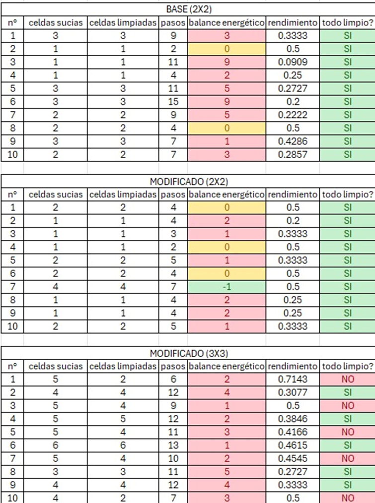
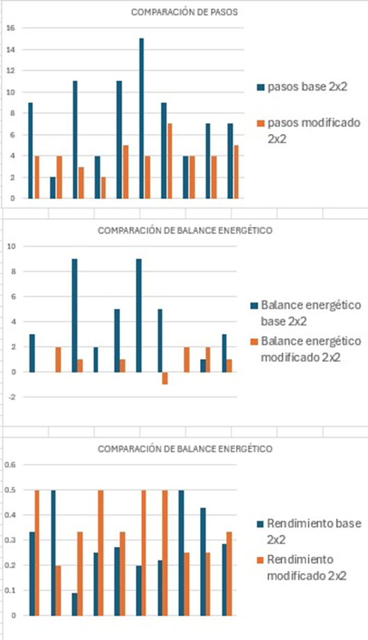

**Enlace al repositorio de GitHub**: \url{https://github.com/JUSTAILS/IA---GRUPO-3}

## Objetivos

### General

Implementar un agente reactivo simple con memoria en un entorno bidimensional para mejorar la eficiencia en la limpieza y el consumo energético en comparación con una arquitectura básica sin estado.

### Específicos

* Analizar las limitaciones y la ineficiencia de un agente reactivo simple básico mediante la ejecución de simulaciones en el entorno de prueba.
* Diseñar una estructura de memoria interna y un patrón de barrido sistemático que permita al agente registrar celdas visitadas y evitar movimientos redundantes.
* Incorporar un mecanismo de parada explícita y métricas de rendimiento para evaluar cuantitativamente la mejora en la autonomía y el consumo energético del agente.

## Introducción

Un agente inteligente es cualquier entidad capaz de percibir su entorno a través de sensores y actuar sobre él mediante actuadores [@russell2020artificial]. Los agentes reactivos simples representan la arquitectura de control más elemental, ya que seleccionan sus acciones únicamente en función de la percepción del estado actual, omitiendo cualquier tipo de historial o memoria de percepciones pasadas. Aunque esta arquitectura destaca por su bajo costo computacional y rapidez de respuesta, presenta limitaciones severas en entornos complejos o de recursos finitos [@wooldridge2009introduction]. Cuando un entorno exige cobertura completa, la ausencia de un estado interno provoca comportamientos erráticos, visitas redundantes y un consumo ineficiente de energía.
El propósito de este trabajo es analizar las ineficiencias de un agente reactivo simple básico, rediseñar su arquitectura incorporando un estado interno de memoria de visitas y evaluar cuantitativamente la mejora en el rendimiento mediante la métrica PEAS.

## Especificación PEAS del agente y entorno

La especificación PEAS (Rendimiento, Entorno, Actuadores, Sensores) define formalmente el problema y establece las capacidades reales del agente dentro de las especificaciones de software implementadas [@russell2020artificial]. A diferencia de enfoques más complejos, la arquitectura de este agente se mantiene estrictamente fiel a una percepción local, lo que se refleja directamente en cada componente del modelo.
En cuanto al rendimiento, este se evalúa maximizando el número de celdas limpias y procurando reducir el consumo energético medido a través de los pasos tomados por el agente mientras intenta limpiar la mayor cantidad de celdas sucias. Asimismo, otra forma de evaluación consiste en establecer una relación entre las casillas limpiadas y los pasos dados por el agente. Estas mediciones permiten observar si el agente opera de manera eficiente y cumple con su meta adecuadamente.
Todo esto toma en cuenta un entorno representado por una cuadrícula bidimensional cuyas celdas adoptan valores de 1 o 0 para indicar si están sucias o limpias, respectivamente, situando inicialmente al agente en una posición aleatoria dentro de la matriz. Con respecto a los actuadores, el agente dispone de acciones para interactuar con el entorno, las cuales son: limpiar la celda actual mediante la instrucción Suck, realizar desplazamientos direccionales válidos dentro de los límites de la matriz (Up, Down, Left, Right) y la condición de parada o finalización (Stop). 
Frente a los sensores, se toma en cuenta que el agente no cuenta con una cámara cenital, un visor global ni ningún mecanismo externo que le indique cuántas celdas están sucias en todo el mapa de manera simultánea. Sus sensores se limitan únicamente a percibir su coordenada actual y el estado de limpieza exacto de la casilla específica en la que se encuentra parado en ese instante. Por esta razón, el agente no conoce el estado global de antemano, y cualquier noción del entorno debe ser descubierta de forma secuencial a través de su propio desplazamiento y el uso de su memoria interna.

## Diagnóstico de ineficiencia del agente base

Al analizar el código base del agente reactivo simple, se observa que este opera únicamente con la percepción local inmediata de su celda actual. Si la celda está sucia, ejecuta la acción de limpiar; si está limpia, toma una decisión de movimiento al azar entre las direcciones adyacentes válidas dentro de los límites de la cuadrícula.
Esta arquitectura básica genera consecuencias directas en el desempeño del sistema. En primer lugar, se produce un movimiento a ciegas, ya que al no almacenar información histórica de las celdas que ya recorrió, el agente frecuentemente re-visita casillas que ya había limpiado previamente, lo que desperdicia recursos y tiempo de ejecución. En segundo lugar, existe una carencia de criterio de autonomía para detenerse, debido a que el agente básico no puede determinar por sí mismo cuándo el entorno está totalmente limpio utilizando únicamente sus sensores locales básicos, provocando que siga moviéndose indefinidamente a menos que un mecanismo externo detenga el ciclo por un límite de pasos. Finalmente, se genera una alta ineficiencia energética, pues al desplazarse de forma aleatoria sin un patrón de barrido ni memoria interna, la cantidad de pasos necesarios para limpiar el entorno se dispara, disminuyendo notablemente la métrica de rendimiento establecida.

## Diseño y mejoras implementadas

Al comparar la evolución del código base frente a la versión mejorada, el cambio principal radica en que el agente dejó de operar en un bucle cerrado sin control para optimizar sus decisiones según el entorno.
Para lograrlo, se amplió el sistema desde una cuadrícula estática de dos por dos hacia un entorno escalable y parametrizable. Asimismo, se le asignó una estructura de memoria interna que funciona como un registro de las casillas ya recorridas. Gracias a esto, el agente filtra sus opciones de movimiento: evalúa las direcciones adyacentes y descarta aquellas que ya exploró, eliminando por completo los desplazamientos redundantes y el desperdicio de recursos.
Adicionalmente, se introdujo una acción de parada mediante un comando explícito, evitando que el agente continúe moviéndose indefinidamente cuando el entorno se encuentra completamente limpio o cuando ya no existen celdas adyacentes pendientes de explorar. Por último, se incorporaron fórmulas de rendimiento empírico que permiten calcular matemáticamente la eficiencia del recorrido dividiendo la suciedad inicial entre los pasos totales dados, junto con una métrica orientada a evaluar los costos de desplazamiento. De esta manera, es posible verificar objetivamente si el agente realiza movimientos innecesarios.

## Resultados

Para evaluar de manera cuantitativa el comportamiento y la eficiencia del agente, se llevaron a cabo pruebas experimentales estructuradas en diez intentos por cada escenario de prueba: el agente base en una cuadrícula de dos por dos, el agente modificado con memoria en la misma dimensión, y el escalamiento del agente modificado a una cuadrícula de tres por tres. Los registros numéricos detallados de estas ejecuciones se presentan en la Figura 1, donde se recopilan las celdas sucias iniciales, las celdas limpiadas, los pasos totales, el balance energético y la relación de rendimiento.

A partir de la observación de los datos tabulados en la Figura 1, se identifica que el agente base en la cuadricula de dos por dos presenta una alta dispersión en los pasos ejecutados, alcanzando hasta quince pasos en el intento seis para limpiar tres casillas debido a su exploración a ciegas. En contraste, los registros del agente modificado en dos por dos muestran que los pasos se reducen a un rango de dos a siete, optimizando el uso de recursos. Al analizar la relación entre los pasos dados y las celdas limpiadas, se puede interpretar esta proporción como un indicador de probabilidad o efectividad: el porcentaje de pasos invertidos en relación con los cuadros limpiados refleja la probabilidad de que el siguiente movimiento del agente lo conduzca de manera directa a una casilla sucia para limpiarla, minimizando los desplazamientos al vacío. Sin embargo, en el escenario escalado de tres por tres de la tercera tabla en la Figura 1, aunque los pasos se mantienen controlados entre seis y trece, la tasa de éxito en la limpieza total se divide al cincuenta por ciento, evidenciando que la visión local pura del agente puede provocar detenciones prematuras en mapas más grandes.
Para contrastar de forma visual las mejoras operativas obtenidas entre el modelo base y el optimizado, se procesaron las métricas en las representaciones graficas que se muestran en la Figura 1.

En la primera gráfica de la Figura 2, correspondiente a la comparación de pasos, se observa claramente como las barras del agente base experimentan picos elevados de hasta quince unidades, mientras que las barras del agente modificado se mantienen estables y acotadas en la parte inferior, confirmando que la memoria interna elimina los recorridos redundantes. En la segunda gráfica de la Figura 2, que evalúa el balance energético, el agente base acumula costos elevados que llegan a nueve unidades de desperdicio por deambular sin rumbo, mientras que el modelo modificado estabiliza su balance cerca de cero o registra valores negativos en escenarios de mayor densidad, lo que demuestra una reducción drástica del consumo energético. Finalmente, en la tercera gráfica de la Figura 2 sobre el rendimiento, la relación entre el trabajo realizado y los pasos tomados muestra que el agente modificado sostiene picos constantes de hasta 0.5, validando que su probabilidad de acierto y su eficiencia operativa mejoraron sustancialmente gracias al patrón de barrido implementado.

## Conclusiones

* La arquitectura del agente reactivo simple basada únicamente en percepciones inmediatas presenta severas limitaciones operativas, como el deambuleo ciego y la ausencia de un criterio autónomo de parada, lo que genera un consumo innecesario de recursos y una baja eficiencia en tareas de cobertura y limpieza.
* La implementación de una estructura de memoria interna y un patrón de barrido sistemático transforma radicalmente el comportamiento del agente, eliminando las trayectorias redundantes sobre casillas ya procesadas, reduciendo el costo energético y optimizando la relación entre los pasos dados y la probabilidad de acierto al encontrar celdas sucias.
* La evaluación empírica en entornos escalados de mayor dimensión demuestra que, si bien la memoria local optimiza el rendimiento en espacios reducidos, la arquitectura basada en percepciones locales puras presenta limitaciones operativas. No obstante, estas deficiencias pueden mitigarse mejorando las capacidades de hardware del agente, permitiéndole integrar procesamiento avanzado para una toma de decisiones más robusta y dotando a sus actuadores de mayor precisión para interactuar de forma óptima con el entorno.

## Referencias
:::{#refs}
:::
